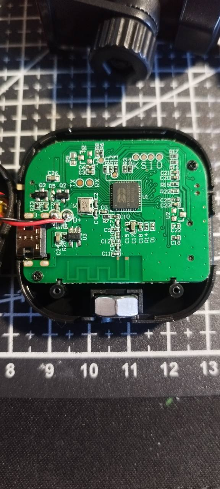
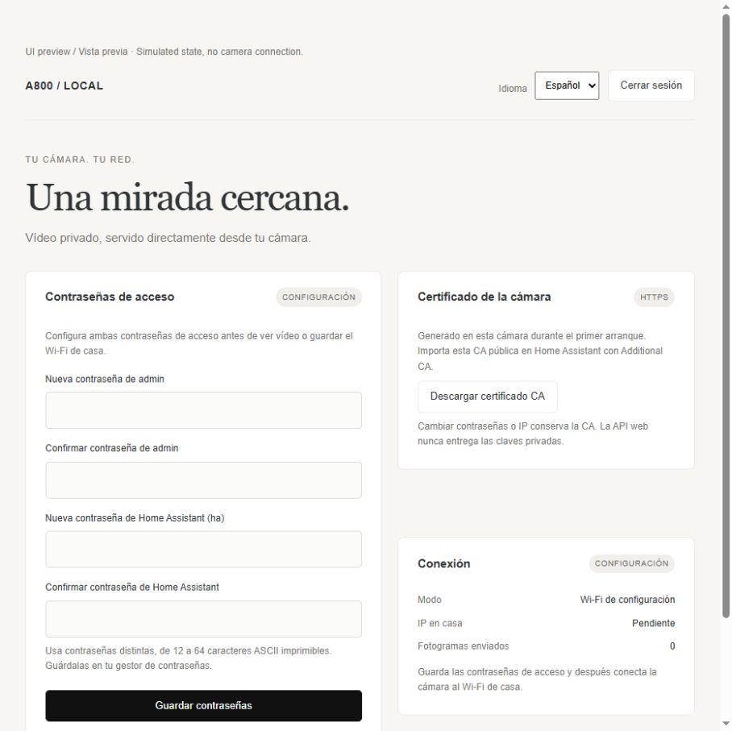
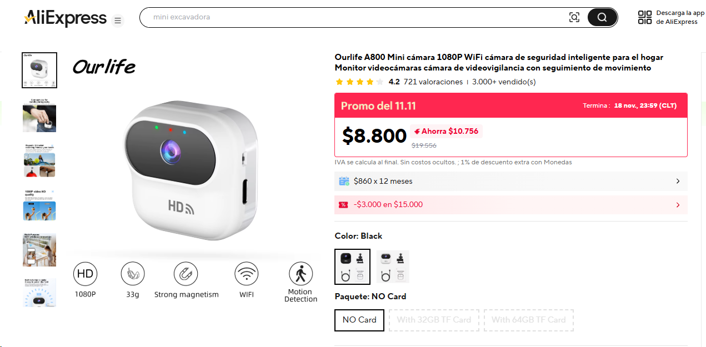
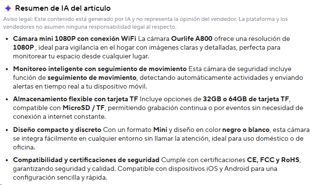

# A800 Local

Firmware autónomo con HTTPS y MJPEG para una mini cámara BK7252N. Sin PC intermediario ni cuenta Linklemo.

[English](README.md) · [Compilar y flashear](docs/BUILD.es.md) · [Home Assistant](docs/HOME_ASSISTANT.es.md) · [Seguridad](SECURITY.md)

## Estado

**Experimental. Una placa probada.** “A800” es un nombre comercial, no una especificación de hardware.

La versión anterior 0.1 funcionó en Home Assistant con HTTPS y validación del certificado. Entregó MJPEG de 640×480 a unos 5 FPS por HTTPS, con un visor simultáneo.

Este código 0.2 añade identidad generada en el primer arranque, cambio de contraseñas y UI ES/EN. Compilación ARM y pruebas en PC correctas. **Falta validar la configuración inicial en la cámara física.** Las mediciones de 0.1 no son pruebas de rendimiento de 0.2.

| Hardware probado | Identificación |
|---|---|
| SoC | Beken BK7252NQN481 |
| Sensor | GC0312, registro ID `0xb3` |
| Flash | 2 MiB, JEDEC `EB6015` |
| PCB / flex | `AKS1N-V2.0` / `XLT-A9-0310-V1.3` |
| Firmware original usado para extraer la tabla | `3.00.21.01_251030` |

## Qué hace

- Sirve MJPEG por HTTPS e imágenes JPEG directamente desde la cámara.
- Genera CA y clave de servidor únicas en el primer arranque; conserva la CA al reiniciar o cambiar de IP.
- Incluye cuentas `admin` y `ha`, cambio de contraseñas, descarga de CA, Wi-Fi guardado e interfaz ES/EN.
- Funciona en la red local. RTSP, ONVIF, grabación, detección de movimiento y OTA **no están implementados**.

La vista previa usa estado simulado. [Versión inglesa](docs/images/ui-setup-en.png) · [Vista móvil](docs/images/ui-setup-mobile-es.png).

## Primera configuración

1. Comprueba la placa, respalda toda la flash y sigue [compilación e instalación](docs/BUILD.es.md).
2. Conéctate a **a800Local**, contraseña **localcam-2026**. Espera a que termine la generación inicial de claves.
3. Abre **https://192.168.4.1/**. El navegador todavía no confía en esta CA nueva; revisa la [confianza inicial](SECURITY.md#first-setup).
4. Entra con **admin / admin**. Ese acceso inicial solo funciona desde el Wi-Fi de configuración.
5. Guarda contraseñas distintas para `admin` y `ha`. Descarga la CA pública desde la UI.
6. Guarda tu Wi-Fi de 2,4 GHz. Abre la IP de casa indicada y [configura Home Assistant](docs/HOME_ASSISTANT.es.md).

El repositorio no comparte claves privadas ni una contraseña predeterminada para Home Assistant. Tras configurar las cuentas, `admin / admin` deja de servir. Si pierdes el acceso, consulta [recuperación](docs/BUILD.es.md#recuperación).

## Qué cámara es

El anuncio proporcionado vende una **Ourlife A800 mini Wi-Fi “1080P”**. La unidad probada usaba Linklemo. La captura verificada aquí es **640×480**. El anuncio no demuestra la resolución del sensor ni compatibilidad con otras placas.

Capturas originales del anuncio, aportadas por el propietario

No se verificaron de forma independiente las promesas del vendedor, el texto generado por IA ni las certificaciones anunciadas.

## Replicar y contribuir

[dependencies.lock.json](dependencies.lock.json) fija las dependencias. Las herramientas las descargan por separado. Cada propietario aporta su respaldo original para extraer la tabla GC0312 compatible.

Git excluye respaldos, tablas del fabricante extraídas, identidades generadas y binarios. Los [avisos de terceros](THIRD_PARTY_NOTICES.md) explican por qué no se publica firmware precompilado.

[Licencia MIT](LICENSE) para el código original del proyecto. Lee el [modelo de seguridad](SECURITY.md) antes de instalarlo.
