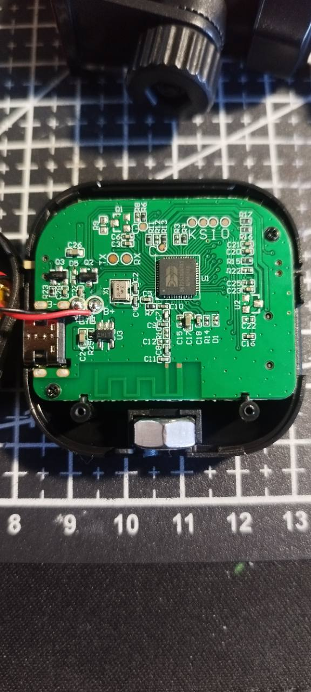
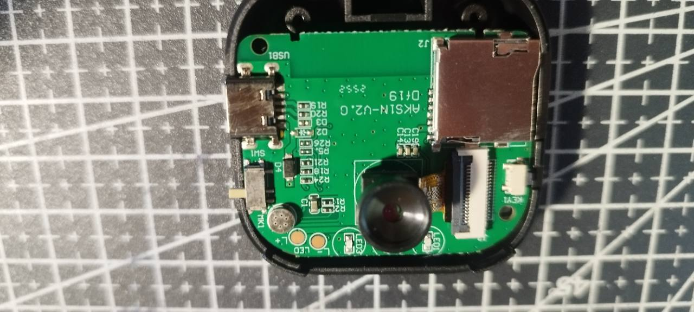
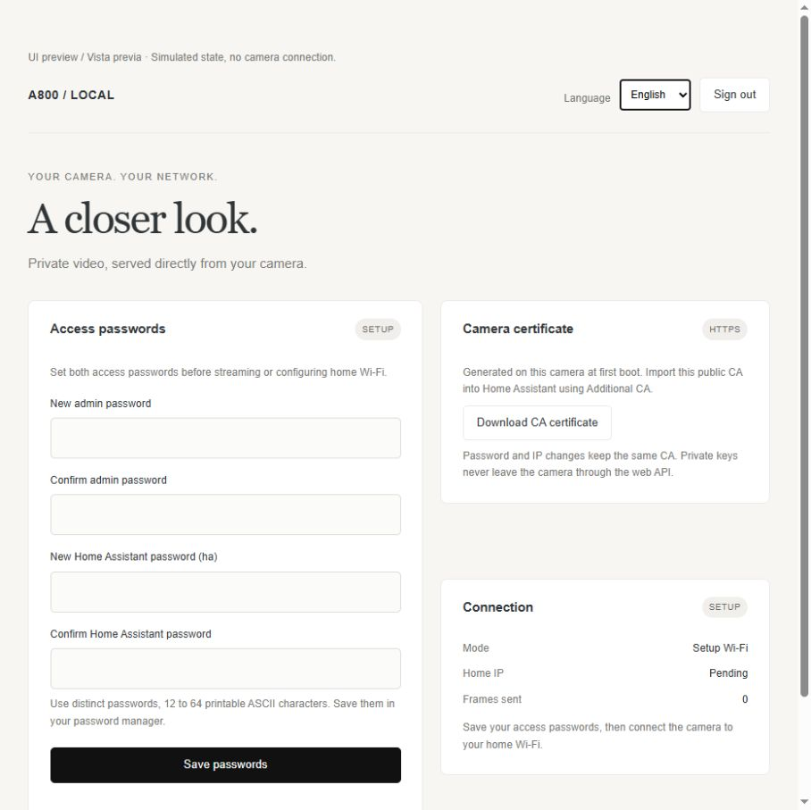
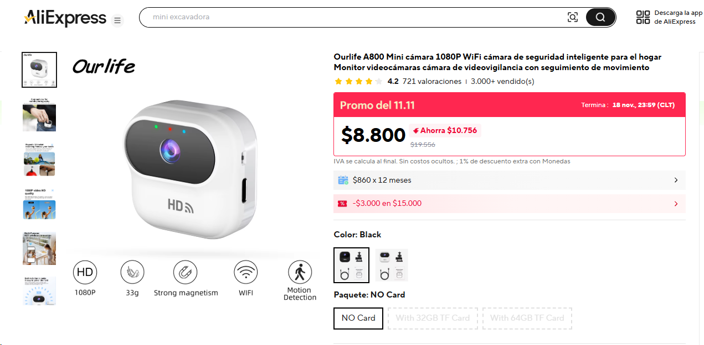
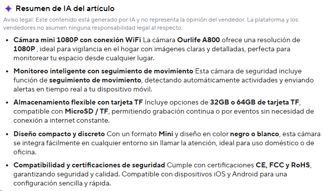

# A800 Local

Standalone HTTPS and MJPEG firmware for a BK7252N mini camera. No PC relay. No Linklemo account.

[Español](README.es.md) · [Build and flash](docs/BUILD.md) · [Home Assistant](docs/HOME_ASSISTANT.md) · [Security](SECURITY.md)

## Status

**Experimental. One board tested.** “A800” is a sales name, not a hardware specification.

The previous 0.1 firmware ran HTTPS video in Home Assistant with certificate verification enabled. It delivered 640×480 MJPEG at about 5 FPS over HTTPS, with one viewer at a time.

This 0.2 source adds on-device first-boot identity, password settings and an ES/EN UI. ARM build and host tests pass. **First-boot onboarding on the physical camera is still awaiting validation.** The 0.1 measurements are not benchmarks of 0.2.

| Tested hardware | Identification |
|---|---|
| SoC | Beken BK7252NQN481 |
| Image sensor | GC0312, register ID `0xb3` |
| Flash | 2 MiB, JEDEC `EB6015` |
| PCB / flex | `AKS1N-V2.0` / `XLT-A9-0310-V1.3` |
| Factory image used for extraction | `3.00.21.01_251030` |

Tested board photos

## What it does

- Serves HTTPS MJPEG and JPEG snapshots directly from the camera.
- Generates a unique CA and server key on first boot; keeps the CA across restarts and IP changes.
- Provides separate `admin` and `ha` accounts, password changes, CA download, saved Wi-Fi and English/Spanish UI.
- Works locally. RTSP, ONVIF, recording, motion detection and OTA are **not implemented**.

UI preview above uses simulated state. [Spanish preview](docs/images/ui-setup-es.png) · [Mobile preview](docs/images/ui-setup-mobile-es.png).

## First setup

1. Verify the board, make a full flash backup, then [build and flash](docs/BUILD.md).
2. Connect to **a800Local**, password **localcam-2026**. Allow time for first-boot key generation.
3. Open **https://192.168.4.1/**. The browser cannot trust a new camera CA yet; see [first-use trust](SECURITY.md#first-setup).
4. Sign in with **admin / admin**. This default works only through setup Wi-Fi.
5. Set distinct passwords for `admin` and `ha`. Download the public CA certificate from the UI.
6. Save your 2.4 GHz home Wi-Fi. Open the displayed home IP, then [configure Home Assistant](docs/HOME_ASSISTANT.md).

No device private key or default Home Assistant password is shared in this repository. Once configured, `admin / admin` stops working. Forgot access? See [recovery](docs/BUILD.md#recovery).

## Which camera?

The supplied listing advertised an **Ourlife A800 “1080P” mini Wi-Fi camera**. The tested unit used Linklemo. Its verified capture here is **640×480**. The listing does not establish sensor resolution or compatibility.

Original listing screenshots supplied by the owner

Seller claims, platform AI text and advertised certifications were not independently verified.

## Replicate, then contribute

Dependencies are pinned in [dependencies.lock.json](dependencies.lock.json). Build scripts fetch them separately. Each owner supplies their own factory backup to extract the supported GC0312 initialization table.

Factory dumps, extracted vendor tables, generated identities and build artifacts stay out of Git. [Third-party notices](THIRD_PARTY_NOTICES.md) explain why there is no prebuilt firmware release.

[MIT license](LICENSE) for original project code. Read the [security model](SECURITY.md) before deployment.
