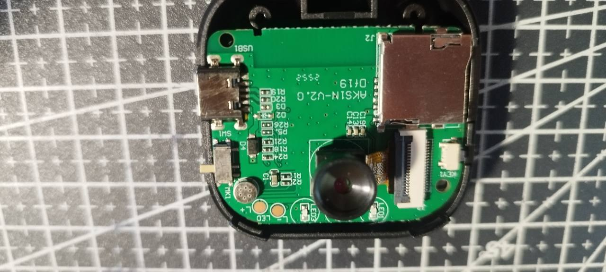

# Compilar y flashear

[English](BUILD.md) · [README](../README.es.md)

Entorno probado: **Windows x64**, Python 3.12+ y Git. Usa una ruta sin espacios. CI ejecuta pruebas de código en Linux; todavía no hay compilación de firmware para Linux/macOS.

## Conexión y respaldo

Usa UART de **3,3 V** a 115200 baudios. Se probó con CH340: TX del adaptador a RX de cámara; RX a TX; GND a GND. Alimenta la cámara con su circuito USB/batería original. No conectes VCC del adaptador a los pads de batería. Identifica TX/RX por la serigrafía de tu placa.



```powershell
git clone https://github.com/Lechuga-visual/A800-Mini-Wifi-Camera---BK7252NQN481.git a800-local
cd a800-local
py -3.12 -m venv .venv
.\.venv\Scripts\python.exe -m pip install -r requirements.txt
.\.venv\Scripts\python.exe tools/bootstrap.py
.\.venv\Scripts\python.exe tools/flash.py backup --port COM3 --backup private/factory.bin
```

`COM3` es un ejemplo: usa el puerto real de tu adaptador. Inicia el comando y reinicia físicamente la cámara cuando indique que está esperando. Quitar USB puede no apagarla si la batería sigue conectada.

El respaldo lee los 2 MiB dos veces y exige coincidencia. Conserva el archivo y su SHA-256 en privado: puede contener credenciales y claves. Nunca reemplaza un respaldo ya existente.

## Configurar y compilar

```powershell
.\.venv\Scripts\python.exe tools/configure.py
.\.venv\Scripts\python.exe tools/extract_sensor.py --backup private/factory.bin
.\.venv\Scripts\python.exe tools/build.py
.\.venv\Scripts\python.exe tools/flash.py prepare --backup private/factory.bin
```

Puedes cambiar `--hostname`, `--ap-ssid` y `--ap-password` en `configure.py`. Los valores predeterminados son `a800-local`, `a800Local` y `localcam-2026`. Las claves de cada cámara se generan en ella; el PC solo prepara opciones y fechas de validez.

La extracción valida el formato y hash de la tabla GC0312 conocida. Rechaza versiones distintas. La tabla del fabricante queda en `build/generated/`, fuera de Git.

El resultado es `build/firmware.bin`. `prepare` añade la imagen física con CRC y un manifiesto de hash. Las dependencias tienen commits/checksums fijos en `dependencies.lock.json`; la compilación usa otro SDK limpio y el parche del proyecto.

## Instalar

```powershell
.\.venv\Scripts\python.exe tools/flash.py install --port COM3 --backup private/factory.bin --write
```

Inicia el instalador, espera su mensaje y apaga/enciende una vez. Mantén alimentación y cables hasta terminar. Sin `--write`, instalar/restaurar/reiniciar acceso no abre el puerto serie.

El instalador comprueba JEDEC, bootloader y RF contra el respaldo; guarda una copia privada del estado actual; rechaza sectores reservados con datos ajenos; y verifica cada borrado y escritura. Ante un fallo intenta restaurar los sectores tocados mientras UART siga conectado. Un corte de alimentación o desconexión requiere recuperación manual.

Regiones físicas del proyecto: aplicación `0x11000..0x132000`, Wi-Fi `0x1E2000..0x1E3000`, identidad A `0x1E3000..0x1E4000`, identidad B `0x1E4000..0x1E5000`. Bootloader, RF y zona de descarga permanecen fuera de la escritura de aplicación. Consulta la [tabla completa](BUILD.md#flash-layout).

## Recuperación

Restaurar aplicación original, conservando bootloader y RF:

```powershell
.\.venv\Scripts\python.exe tools/flash.py restore --port COM3 --backup private/factory.bin --write
```

Si pierdes las contraseñas, este comando borra explícitamente las dos copias de identidad. Generará una CA nueva y habilitará de nuevo el acceso inicial desde el AP. Conserva el Wi-Fi de casa. Después debes importar la CA nueva en los clientes.

```powershell
.\.venv\Scripts\python.exe tools/flash.py reset-access --port COM3 --backup private/factory.bin --write
```

Reflashear solo la aplicación no reinicia las contraseñas. El botón físico de reset todavía no está asignado. OTA sigue desactivado.

## Pruebas y vista previa

```powershell
.\.venv\Scripts\python.exe tests/test_flash_image.py
.\.venv\Scripts\python.exe tests/test_flash_writer.py
.\.venv\Scripts\python.exe tests/test_store.py
.\.venv\Scripts\python.exe tests/test_http.py
.\.venv\Scripts\python.exe tests/test_tls_setup.py
.\.venv\Scripts\python.exe tools/preview.py
```

La prueba TLS requiere haber compilado primero. Ejecuta código TLS/HTTP real con flash simulada en archivos y entropía BCrypt; no sustituye pruebas del sensor, alimentación o generador aleatorio del dispositivo.

Vista previa: `http://127.0.0.1:8768/?state=setup`, `?state=login` o `?state=configured`. Es estado simulado; la cámara real sirve HTTPS.
