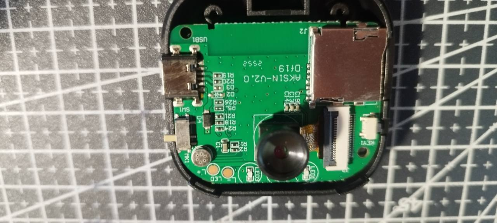

# Build and flash

[Español](BUILD.es.md) · [README](../README.md)

Supported build host: **Windows x64**, Python 3.12+ and Git. Use a checkout path without spaces. Linux CI runs source tests; the firmware build is not yet ported to Linux/macOS.

## Wiring and backup

Use a 3.3 V USB-UART adapter. The tested adapter was CH340, at 115200 baud.

| Adapter | Camera |
|---|---|
| TX | RX |
| RX | TX |
| GND | GND |

Use the PCB TX/RX labels. Do not assume the order of unlabelled pads on another revision. Power the camera through its original USB/battery circuit. Do not connect adapter VCC to the battery pads. A physical off/on cycle is needed for the bootloader handshake; removing USB alone may leave the battery powering the camera.



```powershell
git clone https://github.com/Lechuga-visual/A800-Mini-Wifi-Camera---BK7252NQN481.git a800-local
cd a800-local
py -3.12 -m venv .venv
.\.venv\Scripts\python.exe -m pip install -r requirements.txt
.\.venv\Scripts\python.exe tools/bootstrap.py
.\.venv\Scripts\python.exe tools/flash.py backup --port COM3 --backup private/factory.bin
```

Start the backup command first. Power-cycle when it says it is waiting. It reads all 2 MiB twice and refuses mismatching reads. Store the backup and SHA-256 privately. Backups can contain Wi-Fi/cloud credentials and device keys. An existing backup is never overwritten.

`COM3` is an example. Use your adapter's actual port. Backup/install commands require physical access; they do not use the camera USB port as a programmer.

## Configure and build

```powershell
.\.venv\Scripts\python.exe tools/configure.py
.\.venv\Scripts\python.exe tools/extract_sensor.py --backup private/factory.bin
.\.venv\Scripts\python.exe tools/build.py
.\.venv\Scripts\python.exe tools/flash.py prepare --backup private/factory.bin
```

`configure.py` accepts `--hostname`, `--ap-ssid` and `--ap-password`. Defaults are `a800-local`, `a800Local` and `localcam-2026`. It sets certificate validity bounds at build time, not private device keys. No PC-side identity provisioning is needed.

Sensor extraction accepts the known factory layout and table hash. It rejects unknown versions rather than guessing offsets. The 314-pair vendor table stays in ignored `build/generated/`. Keep your backup outside the repository index.

Output: `build/firmware.bin`, plus a sector-padded physical image and hash manifest from `prepare`. Dependencies are pinned to commits/checksums in `dependencies.lock.json`. The build uses a clean SDK plus the checked-in patch. It does not alter any original SDK used elsewhere on your PC.

## Install

```powershell
.\.venv\Scripts\python.exe tools/flash.py install --port COM3 --backup private/factory.bin --write
```

Without `--write`, install/restore/reset commands only prepare and inspect local files. When writing, start the command, wait for its handshake message, then power-cycle once. Leave the camera powered and cables still until verification finishes.

The tool checks the flash ID, compares bootloader/RF data with your backup, reads the current flash into a private snapshot, and refuses foreign data in reserved sectors. It unprotects before each erase, verifies erased and written sectors, and restores original protection. A write error triggers an attempt to restore touched sectors while UART remains connected. This cannot recover automatically from lost power or a disconnected UART; the bootloader remains available for manual recovery.

## Flash layout

All addresses below are **physical**. Application code uses Beken 32-byte data + 2-byte CRC framing.

| Region | Physical range |
|---|---|
| Preserved bootloader | `0x000000..0x011000` |
| Application slot | `0x011000..0x132000` |
| Preserved download/OTA area | `0x132000..0x1E0000` |
| Preserved RF / SDK parameters | `0x1E0000..0x1E2000` |
| Wi-Fi settings | `0x1E2000..0x1E3000` |
| Identity bank A | `0x1E3000..0x1E4000` |
| Identity bank B | `0x1E4000..0x1E5000` |

The three project settings sectors were erased in the tested factory image. Never assume that on another board. Runtime and installer refuse erasing unknown data there.

## Recovery

Restore the factory application while preserving bootloader and RF:

```powershell
.\.venv\Scripts\python.exe tools/flash.py restore --port COM3 --backup private/factory.bin --write
```

Forgot passwords, or need a new identity? This explicitly erases **both identity banks**, invalidates the old CA, and returns to setup login on next boot. It preserves Wi-Fi settings. Import the newly generated CA into clients afterward.

```powershell
.\.venv\Scripts\python.exe tools/flash.py reset-access --port COM3 --backup private/factory.bin --write
```

Reflashing the application alone does not reset passwords. The physical reset button is not mapped by this firmware. No signed OTA/update recovery flow is implemented.

## Tests

```powershell
.\.venv\Scripts\python.exe tests/test_flash_image.py
.\.venv\Scripts\python.exe tests/test_flash_writer.py
.\.venv\Scripts\python.exe tests/test_store.py
.\.venv\Scripts\python.exe tests/test_http.py
.\.venv\Scripts\python.exe tests/test_tls_setup.py
```

The last test requires built TLS symbols (`tools/build.py`) and runs the actual TLS/HTTP code against file-backed flash and BCrypt entropy on Windows. It checks independent identities, persistence, certificate download, password changes, UI sessions, role separation, initial AP-only access and certificate renewal for a different IP. It is not a sensor, power-loss or on-device TRNG qualification test.

UI preview, without a camera:

```powershell
.\.venv\Scripts\python.exe tools/preview.py
```

Open `http://127.0.0.1:8768/?state=setup`, `?state=login` or `?state=configured`. Preview state is simulated. The camera itself uses HTTPS.
